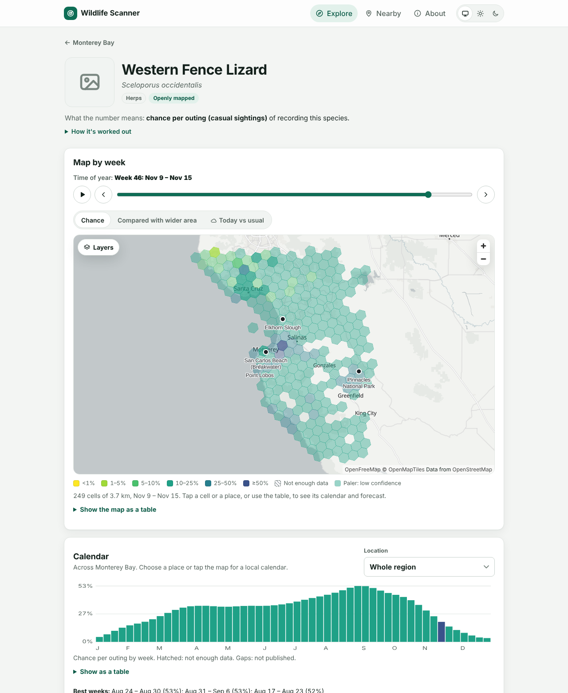
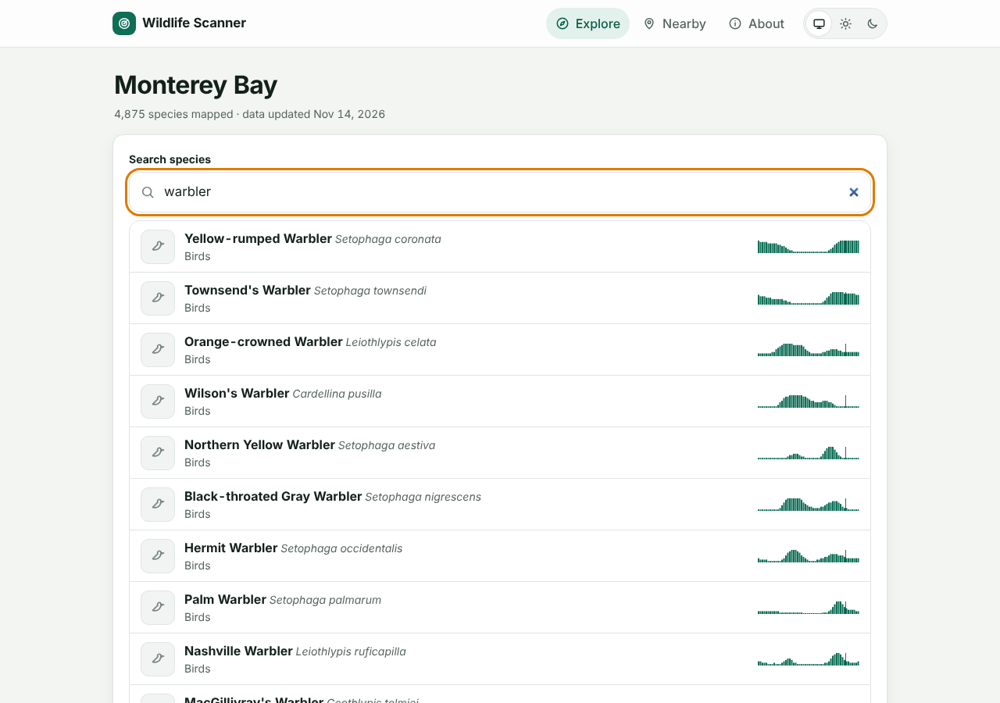
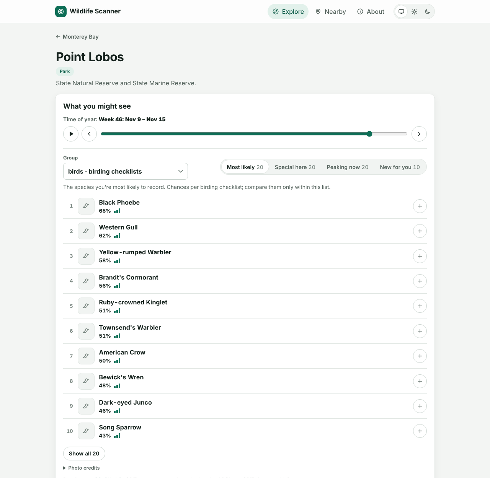
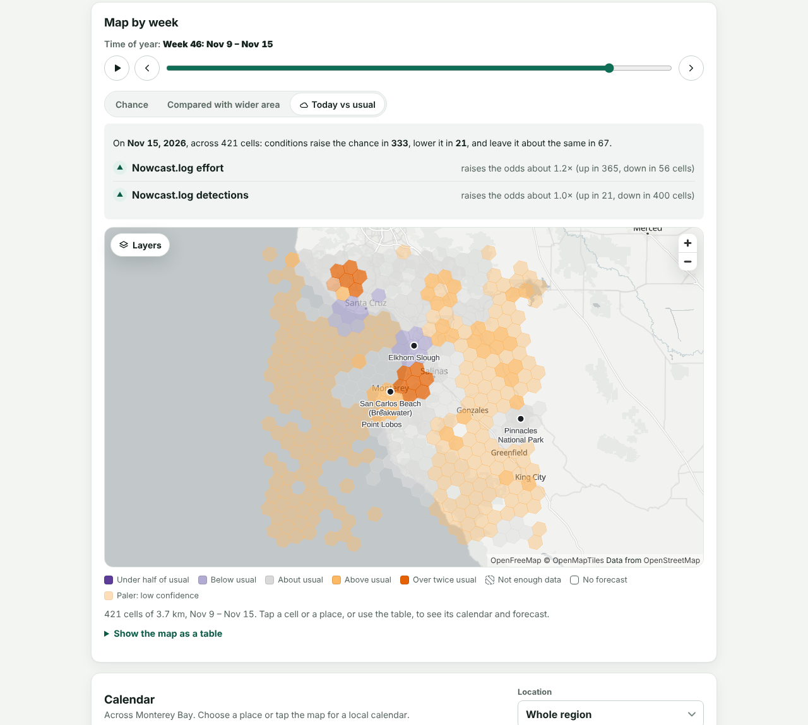
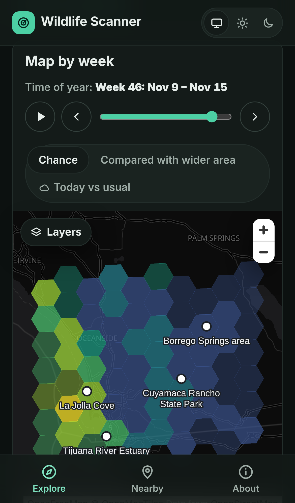
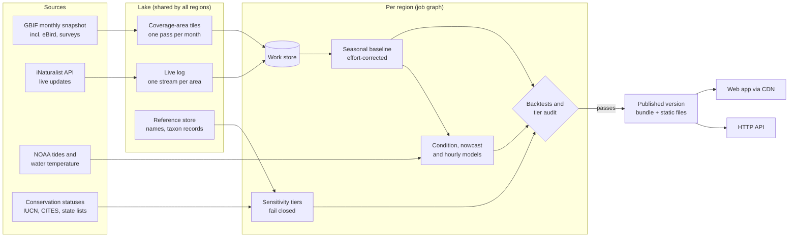

# Wildlife Scanner

**When and where are you likely to see a species?** Wildlife Scanner combines millions of
community and survey observations with environmental conditions, and answers that for every
species with enough data: a map by week of the year, the best places and times, what to
expect at a place this week, and how today compares with usual.

It is free, non-commercial and open source (AGPL-3.0). Sensitive species are protected by
design: their locations are generalized, coarsened or withheld, and nothing finer than the
policy allows ever leaves the pipeline.

The first regions are **Monterey Bay** and **San Diego**, built from one shared California data
area (about 180 million GBIF and iNaturalist records).



## What it does

| | |
|---|---|
|  |  |
| **Search** about 5,000 species per region by common or scientific name. Each result shows a 52-week ribbon of when it is around. | **Places** list, week by week, the species you are most likely to record, those special to the place, and those peaking now, per survey method. |
|  |  |
| **Today vs usual** colours each area by the day's forecast against its usual chance, where a condition model (tides, water temperature, moon, recent sightings) has passed its backtest. | Works on phones, in light and dark mode. Every map and list carries its data licence, and photos carry their credit. |

Screenshots: the web app running on real Monterey Bay data (November 2026). Map data © OpenFreeMap,
OpenMapTiles and OpenStreetMap contributors. Species photos are from iNaturalist under Creative
Commons licences; see [`docs/images/CREDITS.md`](docs/images/CREDITS.md).

Also:

- **Calendars** for any place or map cell, with the best weeks.
- **Time of day**: when in the day (and on which tide) a species is recorded, and an hourly forecast
  for species whose timing model passed its test.
- **Recent activity** near a place: what has been reported in the last two weeks, and what that
  makes more likely today. Records are published with a delay (at least 24 hours).
- **An HTTP API** for everything above, plus static files that a CDN can serve.

## How it works



1. **Ingest once per area.** Each month GBIF's snapshot (which includes eBird, survey programs and
   research-grade iNaturalist records) is read once for the whole coverage area, California here,
   and stored as 1° Parquet tiles. iNaturalist's API feeds a live log every 25 minutes, again once
   for the area. A region inside the area loads its tiles and the new log entries without
   downloading anything itself. Records deleted at the source disappear: monthly through the
   snapshot, daily through a check of recent iNaturalist observations.
2. **Model what observers would see.** The **baseline** estimates, per map cell and week, the chance
   that an outing records the species. It is corrected for where and how people look (checklists,
   casual sightings and surveys are modelled separately), smoothed over space and season, and kept
   only where it beats a range-only map on held-out years. **Condition models** (tides, water
   temperature, moon), **nowcasts** (recent sightings) and **hourly timing models** each have to
   beat the level below them on held-out data, or they are not used.
3. **Protect sensitive species.** Each species gets a tier from authoritative status sources:
   - **open**: weekly maps at the model's resolution (3.7 km cells in the current regions; never
     finer than 1.4 km);
   - **generalized**: weekly, at about 10 km;
   - **coarse**: monthly, at about 70 km, shown as presence only;
   - **withheld**: absent everywhere.

   Missing or failed lookups fail closed, so the species stays protected. Language models never set
   or lower a status. Recent records are published with a delay: 24 hours for open species, 7 days
   for generalized and 30 days for coarse ones.
4. **Publish only what passed.** A region is published only if the tier audit finds no
   high-severity problems. A published version is a read-only bundle for the API plus
   content-addressed static files (maps, place lists and a search index), uploaded before the
   `CURRENT` pointer moves. Unchanged files are reused, so a routine update uploads a few kilobytes.

The design notes go deeper: [`docs/design/framework.md`](docs/design/framework.md) (concepts and
policy), [`docs/design/data-platform.md`](docs/design/data-platform.md) (jobs and storage),
[`docs/design/ingestion.md`](docs/design/ingestion.md) (coverage areas, the live log, deletions),
[`docs/design/factors.md`](docs/design/factors.md) (conditions and time of day), and
[`docs/design/static-products.md`](docs/design/static-products.md) (the file formats the app reads).
The research behind them starts at [`docs/research/00-synthesis.md`](docs/research/00-synthesis.md).

## Try it

Requires Python 3.11 or later and [uv](https://docs.astral.sh/uv/).

```bash
uv sync
uv run pytest
```

Build a small synthetic database and serve it, offline:

```bash
uv run wildlife-scanner demo
uv run wildlife-scanner serve --db data/demo.duckdb
```

Then open `http://127.0.0.1:8000/docs` for the API.

**Real data** for a region (needs network access to GBIF, iNaturalist and NOAA; the first run
takes 1–2 hours and about 20 GB of disk):

```bash
uv run wildlife-scanner run publish --region montereybay --db data/mb.duckdb --lake data/lake \
    --ingest-snapshots
uv run wildlife-scanner serve --region montereybay --bundle-dir data/lake/publish
```

[`docs/running.md`](docs/running.md) walks through each step. [`docs/deploy.md`](docs/deploy.md)
covers scheduled updates, object storage and hosting. The web app lives in `web/`; see its README.

## Repository layout

| Path | What |
|---|---|
| `src/wildlife_scanner/` | the package: connectors, storage, baseline, conditions, policy, pipeline, serving, API |
| `regions/` | region packs: bounding box, places, status scopes, curated statuses, dataset registry |
| `profiles/` | species profiles and guild templates (drafts); see [`profiles/README.md`](profiles/README.md) |
| `web/` | the web app (React, MapLibre, H3) |
| `docs/` | design notes, research, running and deployment |
| `deploy/` | container image and fly.io configs |
| [`DATA_SOURCES.md`](DATA_SOURCES.md) | every data source, its licence and terms |

## Contributing

Contributions are welcome: code, region packs, species knowledge, and reports of anything that
looks wrong. Start with [`CONTRIBUTING.md`](CONTRIBUTING.md).

- **Found a bug or a wrong prediction?** [Open an issue](../../issues/new/choose); the templates
  ask for what we need.
- **Found a sensitive species exposed, or a security problem?** Please don't open a public issue.
  Report it privately as described in [`SECURITY.md`](SECURITY.md).

## License

Wildlife Scanner is an exclusively **non-commercial**, free, educational project.

- **Code:** [GNU AGPL-3.0](LICENSE). If you run a modified version as a network service, you must
  offer its source to your users.
- **Data:** no third-party data is included in this repository. Each source keeps its own licence
  and terms, and many are non-commercial. Anyone running this code is responsible for complying with
  them. See [`docs/design/licensing.md`](docs/design/licensing.md) and [`DATA_SOURCES.md`](DATA_SOURCES.md).

Built on data from GBIF and its publishers, iNaturalist and its observers, eBird (via GBIF), and
NOAA, and on the work of the many people who record wildlife.
